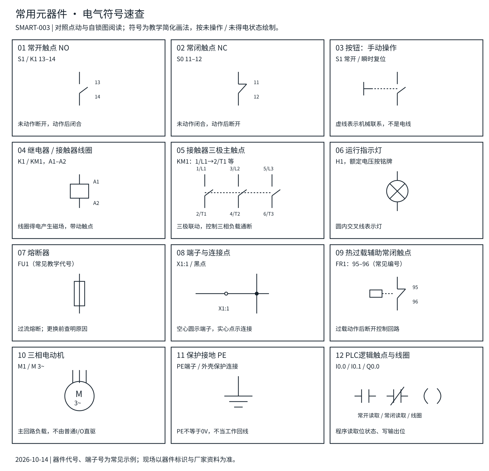

# 常用元器件、原理与电气符号

更新：2026-10-14。配套[点动图](01-点动控制.svg)与[自锁图](02-自锁控制.svg)。本节新知识尚未确认掌握；点动与自锁“已学会”状态保持。

[打开可放大的符号图册](03-常用元器件与电气符号.svg)

## 1 先分清元件、触点和程序

元件是实物，图形符号表达它的功能，器件编号说明“它是谁”，端子号说明“线接到哪里”。同一K1线圈和K1触点分开画，但属于同一个器件。图纸上相距远不表示实物没有关联。

电气触点通常按未操作、线圈未得电状态绘制；热保护按未跳闸状态。常开NO和常闭NC描述这个基准状态，不是看当前程序是否运行。继电器吸合后，常开闭合、常闭断开；实际触点有额定电压、电流、寿命和动作时间，不是理想开关。

本图册是常见画法的教学简化，不能替代项目指定标准与EPLAN器件库。S、K、KM、FU、FR等采用常见学习资料代号，不声称统一适用于所有IEC/EPLAN项目。端子编号示例须以实物印字和厂家资料核对。

## 2 与当前两张图直接相关的元件

| 元件/图册序号 | 工作原理 | 常见标识或端子 | 在当前图纸中的作用 |
|---|---|---|---|
| 常开按钮（01、03） | 手压使触点闭合，松手靠弹簧复位 | S1；示例13–14 | 点动时持续给出命令；自锁时给出启动命令 |
| 常闭停止按钮（02） | 正常导通，按下断开；松手恢复闭合 | S0；示例11–12 | 位于整个控制支路前，停止优先 |
| 继电器线圈（04） | 电流产生磁场，吸引衔铁并带动触点 | K1；A1/A2 | 把电气命令变成触点动作 |
| 辅助常开触点（01） | 随同一继电器线圈动作 | K1；示例13–14 | 自锁图与启动按钮并联，提供保持通路 |
| 指示灯（06） | 额定电压下发光，工业指示灯常含LED模块 | H1；端子按型号 | PLC练习的运行显示负载；未加入上半部继电器图 |
| 端子、接点（08） | 端子连接导线，连接点表示电气节点 | X1:1；实心圆点 | 认识引出线与分支；原图实心点表示支路相连 |

A1/A2是线圈端子，不是线圈的一对常开触点。不能把13–14当线圈接，也不能把A1–A2当开关用。DC线圈若内置二极管或电子模块通常有极性要求；没有资料时不能仅凭端子名推断可随意反接。

### 点动时的电流通路

+24V → S0常闭 → 按住的S1常开 → K1线圈A1 → A2 → 0V。松开S1通路断开，K1释放。点动图没有K1保持触点。

### 自锁时的两条通路

启动瞬间由S1支路给K1供电；K1吸合后其辅助触点闭合。松开S1，电流改经K1辅助触点仍可到达线圈。按下S0同时切断两条支路，K1释放，自己的辅助触点随之断开。

只在S1一条支路上放停止触点是不够的：另一条保持支路可能绕过停止。电源断开后线圈释放；这个电气自锁不是机械锁扣，也不是PLC的断电数据保持。

## 3 后续学习会用到的元件

| 元件/符号 | 原理与用途 | 常见标号/端子示例 | 不能混淆的点 |
|---|---|---|---|
| 接触器（04、05） | 电磁驱动主触点，切换电动机等负载 | KM1；线圈A1/A2；主触点1/L1–2/T1、3/L2–4/T2、5/L3–6/T3 | 主触点承载负载，辅助触点用于控制/反馈，额定能力不同 |
| 熔断器（07） | 熔体因过流发热熔断，切断回路 | FU1，具体端子按器件 | 熔断后不可像按钮一样复位；不得换大规格掩盖故障 |
| 断路器（未绘具体型式） | 根据型号通过热、磁或电子机构检测过流并脱扣 | 常见QF；以型号和图纸规则为准 | 不同类型功能不同；普通过流断路器不等于漏电保护器 |
| 热过载继电器（09） | 检测持续过载并动作，常见双金属或电子式 | 常见FR1；辅助NC 95–96、NO 97–98 | 图册仅画辅助常闭触点，不是三相检测元件全图；通常不能单独承担短路保护 |
| 电动机（10） | 电能转机械能；三相电动机形成旋转磁场 | M1；端子按铭牌 | 图册是负载符号，未画完整动力回路，不能直接接普通PLC输出 |
| 保护接地（11） | 为外露可导电部分提供保护连接 | PE | PE、N、24V电路0V是不同概念，不能因图形相似而短接 |
| 转换触点（文字补充） | 公共端在两条通路间切换 | 常见11公共、12常闭、14常开 | 与单独13–14常开触点不是同一端子组合，核对器件图 |
| 续流二极管（文字补充） | 线圈断电时提供电感电流通路，限制尖峰 | 二极管K为阴极、A为阳极 | 常见直流线圈并联抑制方案中阴极接正常正端；不能照搬到交流线圈，选型会影响释放时间 |

图册05的虚线表示三极机械联动，不是三相电源线互接。按钮符号旁的虚线同样表示机械操作关系。实线交叉有实心连接点才明确表示相连；没有连接点的交叉应结合项目画图规则识别，避免凭外观猜线。

## 4 电气常闭触点与PLC常闭指令不是同一件事

| 对象 | 看什么 | 示例 |
|---|---|---|
| 现场常闭停止按钮 | 未按下时金属触点闭合 | 输入I0.1正常=1，按下或该串联导线断开通常=0 |
| PLC常开读取指令 | 被读取位=1时逻辑成立 | 用常开指令读取I0.1，表示“停止允许” |
| PLC常闭读取指令 | 被读取位=0时逻辑成立 | 若对上述I0.1使用常闭读取，则停止按下时反而成立，含义不同 |
| PLC普通输出线圈 | 网络结果写入位 | Q0.0=1是软件输出命令，不是接触器吸合确认 |
| Q0.0程序保持触点 | 读取输出映像位 | 不需要真的把继电器辅助触点接回输入；若需要状态反馈需另设输入 |

常闭接线有助于发现某些断线，但普通PLC加常闭按钮不自动构成安全回路，也不能识别所有故障。

## 5 看懂图纸的练习

1. 在自锁图找到K1的线圈和辅助触点，说出为什么它们用同一个编号。
2. 分别沿启动和保持通路追线；指出S0为何必须在两条支路外侧。
3. 指出13–14、11–12、A1/A2各代表什么；解释不能任意互换。
4. 解释现场停止按钮是NC，为什么PLC图里I0.1却用常开读取。
5. 区分接触器主触点、辅助触点与线圈；说明电机与PLC输出之间还缺哪些元件。

完成本节阅读不自动标为已学会。图形、链接和逻辑已检查；未做设备实测，精确接线仍需实际型号资料。
