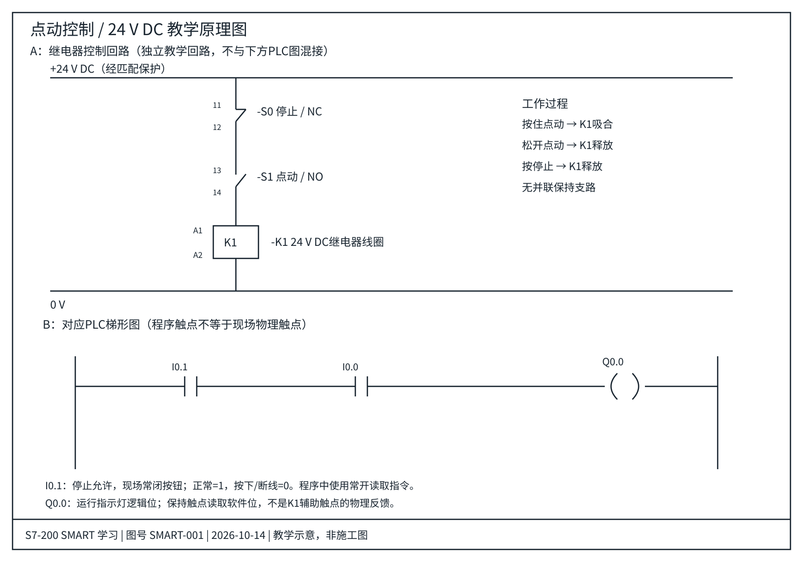

# 01 点动控制

学习状态：已学会（本人反馈）。本页示例实机验证：待记录。

## 原理

按住按钮，输出接通；松开按钮，输出断开。没有保持支路，适合练习输入、触点与输出线圈的关系。

## I/O 分配

| 地址 | 名称 | 接线与状态 |
|---|---|---|
| I0.0 | 点动按钮 | 常开，按下为 1 |
| I0.1 | 停止允许 | 常闭按钮，未按为 1，按下或断线为 0 |
| Q0.0 | 运行指示灯 | 输出为 1 时点亮 |

## 电气原理图与PLC梯形图

[打开矢量原图](../drawings/01-点动控制.svg) · [图纸说明与器件表](../drawings/README.md)

上半部为24V DC继电器回路，下半部为PLC逻辑对照。两者是不同实现，不是接在一起的施工接线图。

逻辑：Q0.0 = I0.1 AND I0.0。

这里 I0.1 的程序触点是常开指令，因为现场常闭停止按钮正常时输入为 1。现场触点类型与程序触点指令不是同一概念。

## 验证步骤

1. 停止按钮正常、未按点动：灯灭。
2. 按住点动：灯亮。
3. 松开点动：灯灭。
4. 按住点动时再按停止：灯灭。
5. 两个按钮同时按下：灯灭，停止优先。

## 容易混淆

- 点动输入若跨越多个扫描周期持续为 1，输出会持续接通。
- 不要添加 Q0.0 保持支路，否则变成自锁。
- 一个输出地址在本练习中只用一个普通线圈。
- CPU 启动进入 RUN 时，若点动按钮已按住且停止允许为 1，本示例会接通输出；需要防意外启动时另加启动许可设计。

## 我的实验

CPU 型号、软件版本、实际接线、程序截图、测试日期与结果：待补充。

## 2026-10-14 更新

本人再次确认已学会；新增带器件编号、端子号和图框的SVG电气图纸及PLC逻辑对照。图纸经过逻辑与显示检查；本仓库示例尚无编译或实机验证记录。

## 元器件与电气符号补充

配套[常用元器件原理与符号](../drawings/03-常用元器件与电气符号.md)，包含NO/NC、按钮、K1线圈与辅助触点、主触点、指示灯、熔断器、热过载、端子、电动机及PE；另有[矢量速查图](../drawings/03-常用元器件与电气符号.svg)。2026-10-14新增，符号学习状态待确认。
