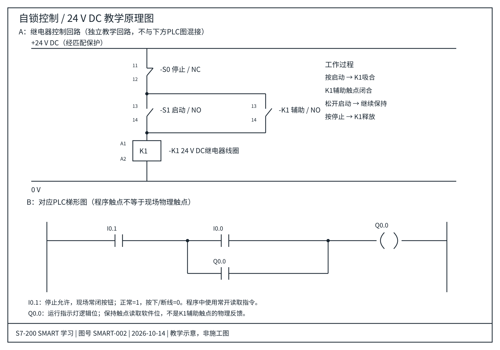

# 02 自锁控制

学习状态：已学会（本人反馈）。本页示例实机验证：待记录。

## 原理

按下启动，Q0.0 接通。Q0.0 的程序触点与启动触点并联，形成保持支路，松开启动后仍接通。按停止切断整个支路，解除保持。

## I/O 分配

| 地址 | 名称 | 接线与状态 |
|---|---|---|
| I0.0 | 启动按钮 | 常开，按下为 1 |
| I0.1 | 停止允许 | 常闭按钮，未按为 1，按下或断线为 0 |
| Q0.0 | 运行指示灯 | 同时用于软件保持触点 |

## 电气原理图与PLC梯形图

[打开矢量原图](../drawings/02-自锁控制.svg) · [图纸说明与器件表](../drawings/README.md)

上半部为24V DC继电器回路，下半部为PLC逻辑对照。两者是不同实现，不是接在一起的施工接线图。

逻辑：Q0.0（本网络执行后）= I0.1 AND（I0.0 OR Q0.0（本网络执行前））。

停止允许位在两条并联支路外侧，停止对启动支路和保持支路都生效，因此同时按启动和停止时输出为 0。

这里 Q0.0 的触点读取软件中的输出位，不是接触器的物理反馈；输出位为 1 不代表电机已实际运行。

## 验证步骤

1. 未按启动：灯灭。
2. 按启动：灯亮。
3. 松开启动：灯继续亮。
4. 按停止：灯灭。
5. 松开停止且启动已松开：灯保持灭。
6. 同时按启动、停止：灯灭。
7. 启动持续按住时松开停止：灯会再次亮。此基础回路不具备“必须重新按启动”的防重启功能。

## 容易混淆

- 自锁是逻辑保持，不等于断电数据保持。
- 不保证上电后自动恢复运行；应单独设计启动初始化和防重启逻辑。
- 不要把停止触点只放在启动支路上，否则保持支路可能绕过停止。
- 本页使用普通线圈与保持触点，不使用 S/R 置位复位指令。
- 在 STEP 7-Micro/WIN SMART 中建立工程并编译，再根据实际接线验证。

## 对比

| 项目 | 点动 | 自锁 |
|---|---|---|
| 松开启动/点动 | 输出断开 | 输出保持 |
| 保持触点 | 无 | Q0.0 与启动并联 |
| 停止 | 切断输出 | 切断并解除保持 |

## 我的实验

CPU 型号、软件版本、实际接线、程序截图、测试日期与结果：待补充。

## 2026-10-14 更新

本人再次确认已学会；新增带器件编号、端子号和图框的SVG电气图纸及PLC逻辑对照。图纸经过逻辑与显示检查；本仓库示例尚无编译或实机验证记录。
